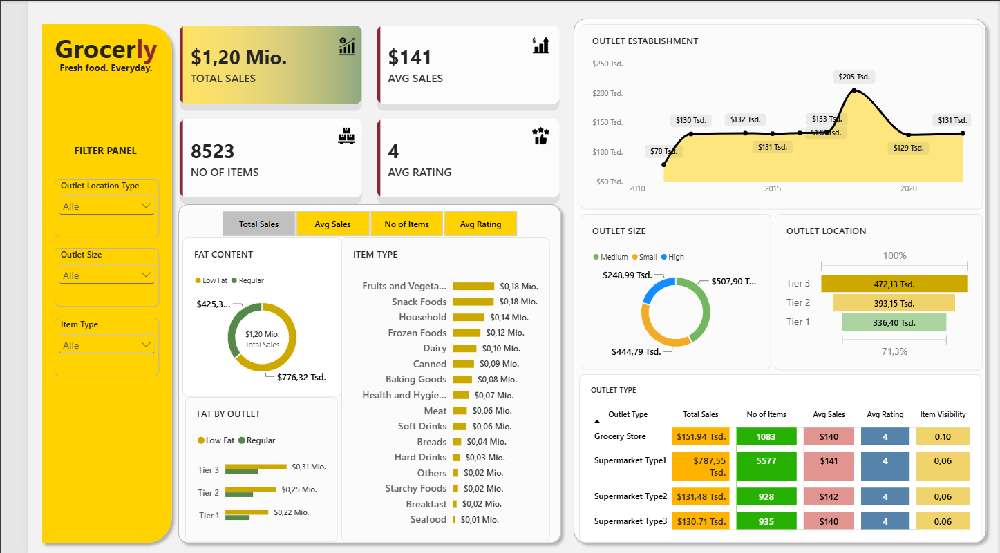

# Grocerly – Grocery Sales Analysis Dashboard

## 1. Project Overview

Grocerly is a Business Intelligence project focused on analyzing grocery sales data using Microsoft Power BI.

The objective is to transform raw sales data into meaningful insights through data cleaning, data modeling, DAX calculations, and interactive visualizations.

## 2. Business Problem

Understanding sales performance is essential for making informed business decisions.

This project aims to provide an overview of grocery sales performance and explore key indicators such as total sales, average sales, number of items, and average customer rating.

## 3. Dataset

- **Dataset:** BlinkIT Grocery Data
- **Format:** Excel
- **Content:** Grocery products, sales figures, item characteristics, and customer ratings.

## 4. Tools & Technologies

- **Microsoft Power BI** – Dashboard development and data visualization
- **Power Query** – Data cleaning and transformation
- **DAX** – Measures and calculations
- **Microsoft Excel** – Source dataset

## 5. Data Preparation

The dataset was prepared using Power Query.

Key preparation steps included:

- Inspecting data quality and identifying missing values.
- Standardizing inconsistent values in the *Item Fat Content* column.
- Checking and correcting data types.
- Reviewing column quality and data consistency.

## 6. Data Modeling & DAX

DAX measures were created to calculate the main performance indicators.

The dashboard also uses a dynamic metric selection to allow users to explore different indicators interactively.

## 7. Key Performance Indicators (KPIs)

The dashboard includes four main KPIs:

- **Total Sales** – Overall sales revenue.
- **Average Sales** – Average sales value.
- **Number of Items** – Total number of records/items.
- **Average Rating** – Average customer rating.

## 8. Dashboard Preview

## 9. Key Insights

The dashboard provides an overview of grocery sales performance and enables users to explore sales distribution across different product categories and characteristics.

*Specific findings will be added based on the analysis of the dashboard.*

## 10. Project Files

- `dashboard/` – Power BI dashboard and preview image.

---

**Project:** Grocerly  
**Category:** Business Intelligence / Data Analytics  
**Tools:** Power BI | Power Query | DAX
